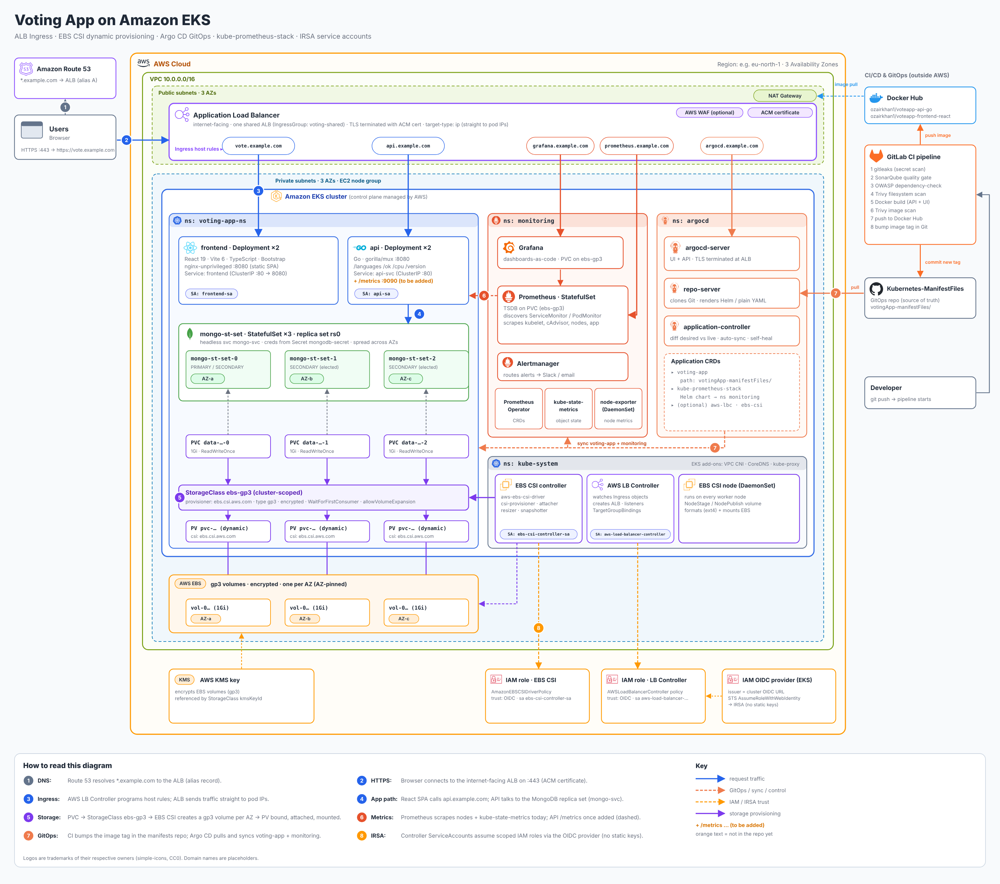
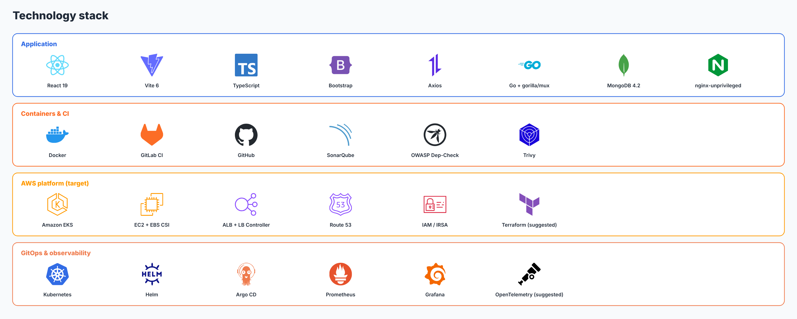
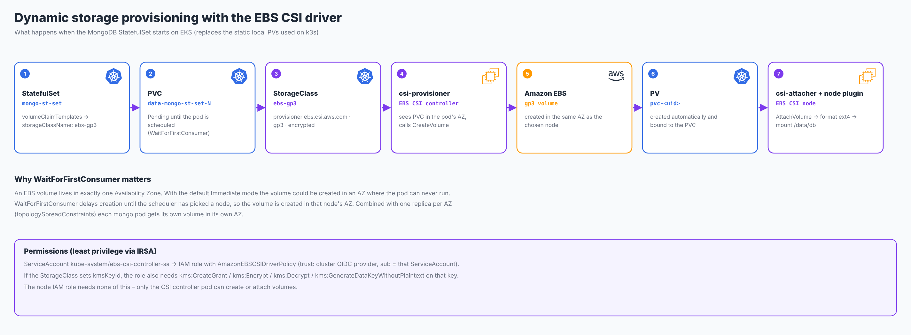
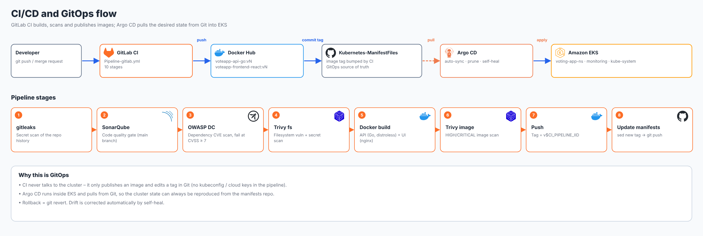

<div align="center">

# 🗳️ Voting App on Amazon EKS

**A three-tier language-voting app (React · Go · MongoDB) delivered to Amazon EKS with ALB Ingress, EBS CSI dynamic storage, Argo CD GitOps and a Prometheus/Grafana monitoring stack.**

<p>
  &nbsp;
  &nbsp;
  &nbsp;
  &nbsp;
  &nbsp;
  &nbsp;
  &nbsp;
  &nbsp;
  &nbsp;
  
</p>

</div>

> **Status.** The app, container images, manifests and the GitLab CI pipeline exist in this repo and have run on a local k3s cluster for local Testing. .
> Everything marked **(planned)** below – EKS, EBS CSI StorageClass, ALB Ingress, Argo CD, ServiceAccounts/IRSA, Prometheus stack – is the target design Implemented On AWS EKS. this README documents; the manifests for it are given inline so it can be used as a future guide for everyone who need Production Implementation. The Architecture diagram has combined both the local Pv and dynamic Pv into same Diagram. One can be used at a time. 
> All images used here live in [`docs/images/`](docs/images/).

---

## Table of contents

1. [Architecture](#1-architecture)
2. [Tech stack](#2-tech-stack)
3. [Repository layout](#3-repository-layout)
4. [The application](#4-the-application)
5. [Storage: EBS CSI dynamic provisioning](#5-storage-ebs-csi-dynamic-provisioning)
6. [CI/CD and GitOps](#6-cicd-and-gitops)
7. [Deploy to EKS, step by step](#7-deploy-to-eks-step-by-step)
8. [Ingress (ALB)](#8-ingress-alb)
9. [ServiceAccounts and IRSA](#9-serviceaccounts-and-irsa)
10. [Observability](#10-observability)
11. [Review findings: fix before going live](#11-review-findings-fix-before-going-live)
12. [Suggested additions](#12-suggested-additions)
13. [Credits](#13-credits)

---

## 1. Architecture

<p align="center">
  
</p>

| # | Step | What happens |
|---|------|--------------|
| 1 | DNS | Route 53 resolves `*.example.com` to the ALB (alias record). |
| 2 | HTTPS | The browser reaches one internet-facing ALB on `:443`; TLS is terminated with an ACM certificate. |
| 3 | Ingress | The AWS Load Balancer Controller turns `Ingress` objects into ALB host rules (one shared ALB via an *IngressGroup*) and registers **pod IPs** directly (`target-type: ip`). |
| 4 | App path | The React SPA is served by `frontend`, then calls `api.example.com`; the Go API talks to the MongoDB replica set through the headless service `mongo-svc`. |
| 5 | Storage | `volumeClaimTemplates` → StorageClass `ebs-gp3` → EBS CSI controller creates a gp3 volume per AZ → PV bound and mounted. |
| 6 | Metrics | Prometheus scrapes nodes and kube-state-metrics, and the API once `/metrics` is added. Developers Limitation |
| 7 | GitOps | GitLab CI pushes an image and bumps the tag in the manifests repo; Argo CD pulls and syncs `voting-app` and the monitoring stack. |
| 8 | IRSA | Controller ServiceAccounts assume scoped IAM roles through the cluster OIDC provider – no static AWS keys. |

---

## 2. Tech stack | Developer -> Cloud Academy | Devops -> Ozair Khan  

<p align="center">
  
</p>

| Layer | Tool | Version / detail (from this repo) |
|-------|------|-----------------------------------|
| Frontend |  React +  Vite +  TypeScript | React 19.1, Vite 6.3, TS 5.8, Bootstrap 5.3, Axios |
| Frontend runtime |  nginx-unprivileged | `nginxinc/nginx-unprivileged:1.27-alpine`, port 8080, non-root |
| API |  Go | gorilla/mux, mongo-driver 1.11; built with Go 1.23, `distroless/static:nonroot` image |
| Database |  MongoDB | `mongo:4.2` StatefulSet ×3, replica set `rs0` |
| Containers |  Docker | multi-stage builds, Docker Hub (`ozairkhan1/*`) |
| CI |  GitLab CI | gitleaks,  SonarQube,  OWASP Dependency-Check,  Trivy |
| Orchestration |  Amazon EKS | managed control plane + managed node group |
| Ingress |  AWS Load Balancer Controller | ALB, IngressGroup, ACM TLS |
| Storage |  AWS EBS CSI driver | gp3, `WaitForFirstConsumer` |
| Identity |  IAM / IRSA | one role per controller ServiceAccount |
| GitOps |  Argo CD | Applications for the app and the monitoring stack |
| Monitoring |  Prometheus +  Grafana | `kube-prometheus-stack` Helm chart |
| DNS |  Route 53 | alias records to the ALB |

---

## 3. Repository layout

```text
.
├── Pipeline-gitlab.yml              # GitLab CI: scan → build → push → bump manifests
├── voteapp-api-go/                  # Go REST API (main.go, Dockerfile)
├── voteapp-frontend-react/          # React + Vite SPA (Dockerfile, nginx config)
├── votingApp-manifestFiles/         # Kubernetes manifests (namespace voting-app-ns)
│   ├── api-dep.yml  api-svc.yml
│   ├── frontend-dep.yml  frontend-svc.yml
│   ├── mongo-st-set.yml  mongo-svc.yml  mongo-secret.yml
│   └── pv.yml                       # static local PVs (k3s only – replaced by CSI on EKS)
└── docs/images/                     # all diagrams + logos used in this README
    ├── architecture.png / .svg
    ├── cicd-gitops-flow.png
    ├── ebs-csi-dynamic-provisioning.png
    ├── tech-stack.png
    ├── logos/                       # tool logos (SVG)
    └── src/                         # scripts that regenerate the diagrams
```

---

## 4. The application

Users vote for their favourite programming language; votes are stored in MongoDB (`langdb.languages`).

**API endpoints** (`voteapp-api-go/main.go`, port `8080`):

| Method | Path | Purpose |
|--------|------|---------|
| GET | `/languages` | all languages with vote counts |
| GET | `/languages/{name}` | one language |
| GET | `/languages/{name}/vote` | cast a vote (atomic `$inc`) |
| POST / DELETE | `/languages/{name}` | create / delete a language |
| GET | `/ok` | liveness + readiness probe |
| GET | `/cpu`, `/version` | host CPU info, build version |

**Configuration**

| Component | Setting | Notes |
|-----------|---------|-------|
| API | `MONGO_CONN_STR`, `MONGO_USERNAME`, `MONGO_PASSWORD` | from the manifest and Secret `mongodb-secret` |
| Frontend | `window._env_.API_BASE_URL` in `public/env-config.js` | read **in the browser**, so it must be the public API URL (`https://api.example.com`) |

**Run locally**

```bash
docker build -t voteapp-api-go      ./voteapp-api-go
docker build -t voteapp-frontend    ./voteapp-frontend-react
docker network create vote && docker run -d --name mongo --network vote mongo:4.2
docker run -d --network vote -p 8080:8080 -e MONGO_CONN_STR=mongodb://mongo:27017/langdb voteapp-api-go
docker run -d -p 3000:8080 voteapp-frontend
```

---

## 5. Storage: EBS CSI dynamic provisioning

<p align="center">
  
</p>

> **Where the repo is today.** `votingApp-manifestFiles/pv.yml` defines three **static** `local` PVs pinned to `node-01`/`node-02`, and `mongo-st-set.yml` uses `storageClassName: ""`. That is the k3s local testing  setup. The CSI-based design below is what runs on EKS, and `pv.yml` is **not applied** there.

**1. Install the driver as an EKS add-on (IRSA role, no node-role permissions)**

```bash
export CLUSTER=voting-eks REGION=us-east-1
eksctl utils associate-iam-oidc-provider --cluster $CLUSTER --region $REGION --approve

eksctl create iamserviceaccount --cluster $CLUSTER --region $REGION \
  --namespace kube-system --name ebs-csi-controller-sa \
  --role-name AmazonEKS_EBS_CSI_DriverRole --role-only \
  --attach-policy-arn arn:aws:iam::aws:policy/service-role/AmazonEBSCSIDriverPolicy --approve

eksctl create addon --cluster $CLUSTER --region $REGION --name aws-ebs-csi-driver \
  --service-account-role-arn arn:aws:iam::<ACCOUNT_ID>:role/AmazonEKS_EBS_CSI_DriverRole --force
```

**2. StorageClass** (`votingApp-manifestFiles/storageclass.yml` – new)

```yaml
apiVersion: storage.k8s.io/v1
kind: StorageClass
metadata:
  name: ebs-gp3
provisioner: ebs.csi.aws.com
parameters:
  type: gp3
  encrypted: "true"
  fsType: ext4
volumeBindingMode: WaitForFirstConsumer   # create the volume in the AZ the pod lands in
allowVolumeExpansion: true
reclaimPolicy: Delete                     # use Retain if you must keep data after PVC deletion
```
  
**3. Verify**

```bash
kubectl get sc ebs-gp3
kubectl -n voting-app-ns get pvc,pv          # PVCs Bound, PVs named pvc-<uid>
aws ec2 describe-volumes --filters Name=tag:kubernetes.io/created-for/pvc/namespace,Values=voting-app-ns \
  --query 'Volumes[].[VolumeId,AvailabilityZone,VolumeType,Encrypted]' --output table
```

---

## 6. CI/CD and GitOps

<p align="center">
  
</p>

`Pipeline-gitlab.yml` has ten stages: `validate → secret_scan → test → sonarqube → dependency_scan → trivy_fs_scan → docker_build → trivy_image_scan → docker_push → update_manifests`. Images are tagged `v$CI_PIPELINE_IID`. The last job clones `OzairKhan1/Kubernetes-ManifestFiles`, rewrites the image tag and pushes, which is the change Argo CD reacts to.

**Argo CD** Both Script and UI-Method is Shown for Argo Cd. (Helm, behind the ALB – TLS ends at the ALB, so the server runs in insecure/HTTP mode):

```bash
helm repo add argo https://argoproj.github.io/argo-helm && helm repo update
helm install argocd argo/argo-cd -n argocd --create-namespace -f argocd-values.yaml
```

```yaml
# argocd-values.yaml
global:
  domain: argocd.example.com
configs:
  params:
    server.insecure: true
server:
  ingress:
    enabled: true
    ingressClassName: alb
    annotations:
      alb.ingress.kubernetes.io/group.name: voting-shared
      alb.ingress.kubernetes.io/scheme: internet-facing
      alb.ingress.kubernetes.io/target-type: ip
      alb.ingress.kubernetes.io/listen-ports: '[{"HTTPS":443}]'
      alb.ingress.kubernetes.io/certificate-arn: arn:aws:acm:<region>:<account>:certificate/<id>
      alb.ingress.kubernetes.io/backend-protocol: HTTP
      alb.ingress.kubernetes.io/healthcheck-path: /healthz
```

**Application** that deploys this repo's manifests:

```yaml
apiVersion: argoproj.io/v1alpha1
kind: Application
metadata:
  name: voting-app
  namespace: argocd
spec:
  project: default
  source:
    repoURL: https://github.com/OzairKhan1/Kubernetes-ManifestFiles.git
    targetRevision: main
    path: votingApp-manifestFiles
  destination:
    server: https://kubernetes.default.svc
    namespace: voting-app-ns
  syncPolicy:
    automated: { prune: true, selfHeal: true }
    syncOptions: [CreateNamespace=true]
```

Login: `kubectl -n argocd get secret argocd-initial-admin-secret -o jsonpath='{.data.password}' | base64 -d`. For the CLI through an ALB use `argocd login argocd.example.com --grpc-web`.

---

## 7. Deploy to EKS, step by step

| Step | Action | Where |
|------|--------|-------|
| 1 | Create the cluster (3 AZs, private node group) and the OIDC provider | `eksctl` or Terraform |
| 2 | Install the **EBS CSI** add-on + `ebs-gp3` StorageClass | [§5](#5-storage-ebs-csi-dynamic-provisioning) |
| 3 | Install the **AWS Load Balancer Controller** | below |
| 4 | Install **Argo CD** | [§6](#6-cicd-and-gitops) |
| 5 | Create the `voting-app` Application → Argo CD deploys the app | [§6](#6-cicd-and-gitops) |
| 6 | Install **kube-prometheus-stack** (as an Argo CD Application or Helm) | [§10](#10-observability) |
| 7 | Point Route 53 records at the ALB | alias `A` record per host, or ExternalDNS |
| 8 | Initialise the MongoDB replica set (once) | below |

**AWS Load Balancer Controller**

```bash
curl -o iam_policy.json https://raw.githubusercontent.com/kubernetes-sigs/aws-load-balancer-controller/main/docs/install/iam_policy.json
aws iam create-policy --policy-name AWSLoadBalancerControllerIAMPolicy --policy-document file://iam_policy.json

eksctl create iamserviceaccount --cluster $CLUSTER --region $REGION \
  --namespace kube-system --name aws-load-balancer-controller \
  --attach-policy-arn arn:aws:iam::<ACCOUNT_ID>:policy/AWSLoadBalancerControllerIAMPolicy --approve

helm repo add eks https://aws.github.io/eks-charts && helm repo update
helm install aws-load-balancer-controller eks/aws-load-balancer-controller -n kube-system \
  --set clusterName=$CLUSTER --set serviceAccount.create=false --set serviceAccount.name=aws-load-balancer-controller
```

**MongoDB replica set** – the manifests start `mongod --replSet rs0` but nothing runs `rs.initiate`, so do it once (or turn it into a Job). The Script helps to Initilize the Primary Database and 2 Secondary Databases. :

```bash
kubectl exec -i -n voting-app-ns mongo-st-set-0 -- mongo --quiet <<'EOF'
rs.initiate({
  _id: "rs0",   // must match your --replSet value
  members: [
    {_id: 0, host: "mongo-st-set-0.mongo-svc:27017"},
    {_id: 1, host: "mongo-st-set-1.mongo-svc:27017"},
    {_id: 2, host: "mongo-st-set-2.mongo-svc:27017"}
  ]
})
EOF
```
---

**Adding Data to Database**
```bash
cat << EOF | kubectl exec -it mongo-st-set-0 -- mongo
use langdb;
db.languages.insert({"name" : "csharp", "codedetail" : { "usecase" : "system, web, server-side", "rank" : 5, "compiled" : false, "homepage" : "https://dotnet.microsoft.com/learn/csharp", "download" : "https://dotnet.microsoft.com/download/", "votes" : 0}});
db.languages.insert({"name" : "python", "codedetail" : { "usecase" : "system, web, server-side", "rank" : 3, "script" : false, "homepage" : "https://www.python.org/", "download" : "https://www.python.org/downloads/", "votes" : 0}});
db.languages.insert({"name" : "javascript", "codedetail" : { "usecase" : "web, client-side", "rank" : 7, "script" : false, "homepage" : "https://en.wikipedia.org/wiki/JavaScript", "download" : "n/a", "votes" : 0}});
db.languages.insert({"name" : "go", "codedetail" : { "usecase" : "system, web, server-side", "rank" : 12, "compiled" : true, "homepage" : "https://golang.org", "download" : "https://golang.org/dl/", "votes" : 0}});
db.languages.insert({"name" : "java", "codedetail" : { "usecase" : "system, web, server-side", "rank" : 1, "compiled" : true, "homepage" : "https://www.java.com/en/", "download" : "https://www.java.com/en/download/", "votes" : 0}});
db.languages.insert({"name" : "nodejs", "codedetail" : { "usecase" : "system, web, server-side", "rank" : 20, "script" : false, "homepage" : "https://nodejs.org/en/", "download" : "https://nodejs.org/en/download/", "votes" : 0}});

db.languages.find().pretty();
EOF
```
---

## 8. Ingress (ALB)

With `target-type: ip` the ALB talks to pod IPs, so the Services can be plain `ClusterIP` (the current `NodePort` values `30351`/`32222` are k3s leftovers and can be removed). One file, one ALB shared with Argo CD and Grafana through the IngressGroup:

```yaml
apiVersion: networking.k8s.io/v1
kind: Ingress
metadata:
  name: voting-app
  namespace: voting-app-ns
  annotations:
    alb.ingress.kubernetes.io/group.name: voting-shared
    alb.ingress.kubernetes.io/scheme: internet-facing
    alb.ingress.kubernetes.io/target-type: ip
    alb.ingress.kubernetes.io/listen-ports: '[{"HTTP":80},{"HTTPS":443}]'
    alb.ingress.kubernetes.io/ssl-redirect: "443"
    alb.ingress.kubernetes.io/certificate-arn: arn:aws:acm:<region>:<account>:certificate/<id>
    alb.ingress.kubernetes.io/healthcheck-path: /ok
spec:
  ingressClassName: alb
  rules:
    - host: vote.example.com
      http:
        paths:
          - { path: /, pathType: Prefix, backend: { service: { name: frontend, port: { number: 80 } } } }
    - host: api.example.com
      http:
        paths:
          - { path: /, pathType: Prefix, backend: { service: { name: api-svc, port: { number: 80 } } } }
```

Then set `API_BASE_URL` to `https://api.example.com`. Because the browser reads it, restrict CORS in `main.go` to `https://vote.example.com` instead of `*`.

**Don't expose Prometheus publicly without authentication.** Use `alb.ingress.kubernetes.io/scheme: internal` (VPN/bastion), `alb.ingress.kubernetes.io/inbound-cidrs: <your-ip>/32`, or ALB OIDC/Cognito authentication (`alb.ingress.kubernetes.io/auth-type`).

---

## 9. ServiceAccounts and IRSA

Two kinds of ServiceAccounts are involved.

| ServiceAccount | Namespace | AWS permissions | Purpose |
|----------------|-----------|-----------------|---------|
| `ebs-csi-controller-sa` | kube-system | `AmazonEBSCSIDriverPolicy` (IRSA) | create/attach EBS volumes |
| `aws-load-balancer-controller` | kube-system | LB Controller policy (IRSA) | manage ALBs and target groups |
| `api-sa` | voting-app-ns | none | dedicated identity for the API pods |
| `frontend-sa` | voting-app-ns | none | dedicated identity for the UI pods |

Today both app Deployments run under the namespace `default` ServiceAccount, which gets an API token mounted it never uses. Give each workload its own identity and drop the token:

```yaml
apiVersion: v1
kind: ServiceAccount
metadata: { name: api-sa, namespace: voting-app-ns }
automountServiceAccountToken: false
---
apiVersion: v1
kind: ServiceAccount
metadata: { name: frontend-sa, namespace: voting-app-ns }
automountServiceAccountToken: false
```

and in each Deployment's pod spec add `serviceAccountName: api-sa` (or `frontend-sa`). If the API later needs AWS (for example Secrets Manager), annotate `api-sa` with `eks.amazonaws.com/role-arn: arn:aws:iam::<account>:role/<least-privilege-role>`. **EKS Pod Identity** is the newer alternative to IRSA and avoids the OIDC trust-policy wiring.

---

## 10. Observability

### Does the app expose metrics today? No.

Checked in the code: `voteapp-api-go` has no `/metrics` route and no Prometheus client in `go.mod`; routes are only `/languages…`, `/ok`, `/cpu`, `/version`. The frontend is static nginx and MongoDB has no exporter. Prometheus will therefore see the **platform** (nodes, kubelet, cAdvisor container CPU/memory, kube-state-metrics, pod restarts) but **no application metrics** until the API is instrumented.

### Install the stack

```bash
helm repo add prometheus-community https://prometheus-community.github.io/helm-charts && helm repo update
helm install kps prometheus-community/kube-prometheus-stack -n monitoring --create-namespace -f monitoring-values.yaml
```

```yaml
# monitoring-values.yaml
prometheus:
  prometheusSpec:
    serviceMonitorSelectorNilUsesHelmValues: false   # pick up ServiceMonitors from any namespace
    retention: 15d
    storageSpec:
      volumeClaimTemplate:
        spec:
          storageClassName: ebs-gp3
          accessModes: ["ReadWriteOnce"]
          resources: { requests: { storage: 20Gi } }
  ingress:
    enabled: true
    ingressClassName: alb
    hosts: [prometheus.example.com]
    paths: ["/"]
    pathType: Prefix
    annotations:
      alb.ingress.kubernetes.io/group.name: voting-shared
      alb.ingress.kubernetes.io/scheme: internal          # or restrict with inbound-cidrs / OIDC auth
      alb.ingress.kubernetes.io/target-type: ip
grafana:
  adminPassword: change-me                                 # use an existing Secret in real use
  persistence: { enabled: true, storageClassName: ebs-gp3, size: 5Gi }
  ingress:
    enabled: true
    ingressClassName: alb
    hosts: [grafana.example.com]
    annotations:
      alb.ingress.kubernetes.io/group.name: voting-shared
      alb.ingress.kubernetes.io/scheme: internet-facing
      alb.ingress.kubernetes.io/target-type: ip
alertmanager:
  alertmanagerSpec:
    storage:
      volumeClaimTemplate:
        spec:
          storageClassName: ebs-gp3
          accessModes: ["ReadWriteOnce"]
          resources: { requests: { storage: 2Gi } }
```

> Keep all hosts on one ALB with the same `group.name`, and keep `scheme` consistent *within* a group. A group cannot mix `internal` and `internet-facing`; if Prometheus must be internal, give it its own group.

### Add `/metrics` to the API

```bash
cd voteapp-api-go && go get github.com/prometheus/client_golang@latest && go mod tidy
```

Serve metrics on a **separate internal port (9090)** so they are never reachable through the public ALB:

```go
import (
    "github.com/prometheus/client_golang/prometheus"
    "github.com/prometheus/client_golang/prometheus/promauto"
    "github.com/prometheus/client_golang/prometheus/promhttp"
)

var (
    httpRequests = promauto.NewCounterVec(prometheus.CounterOpts{
        Name: "voteapp_http_requests_total", Help: "HTTP requests by route and status"},
        []string{"method", "route", "code"})
    httpDuration = promauto.NewHistogramVec(prometheus.HistogramOpts{
        Name: "voteapp_http_request_duration_seconds", Help: "Request latency", Buckets: prometheus.DefBuckets},
        []string{"route"})
    votesTotal = promauto.NewCounterVec(prometheus.CounterOpts{
        Name: "voteapp_votes_total", Help: "Votes cast per language"}, []string{"language"})
)

type statusRecorder struct{ http.ResponseWriter; code int }
func (r *statusRecorder) WriteHeader(c int) { r.code = c; r.ResponseWriter.WriteHeader(c) }

func metricsMiddleware(next http.Handler) http.Handler {
    return http.HandlerFunc(func(w http.ResponseWriter, r *http.Request) {
        start := time.Now()
        rec := &statusRecorder{ResponseWriter: w, code: 200}
        next.ServeHTTP(rec, r)
        route := r.URL.Path
        if cr := mux.CurrentRoute(r); cr != nil {
            if t, err := cr.GetPathTemplate(); err == nil { route = t }
        }
        httpRequests.WithLabelValues(r.Method, route, strconv.Itoa(rec.code)).Inc()
        httpDuration.WithLabelValues(route).Observe(time.Since(start).Seconds())
    })
}

// in main():
router.Use(metricsMiddleware)
go func() {
    m := http.NewServeMux()
    m.Handle("/metrics", promhttp.Handler())
    log.Fatal(http.ListenAndServe(":9090", m))
}()
// in voteonlanguage(), after the vote succeeds:
votesTotal.WithLabelValues(name).Inc()
```

Expose the port and tell Prometheus about it:

```yaml
# api-dep.yml  (container ports)            # api-svc.yml (Service ports) – name the ports
ports:                                      ports:
  - { containerPort: 8080, name: http }       - { name: http,    port: 80,   targetPort: http }
  - { containerPort: 9090, name: metrics }    - { name: metrics, port: 9090, targetPort: metrics }
```

```yaml
apiVersion: monitoring.coreos.com/v1
kind: ServiceMonitor
metadata: { name: api, namespace: voting-app-ns, labels: { release: kps } }
spec:
  selector: { matchLabels: { role: api } }
  endpoints: [{ port: metrics, interval: 30s }]
```

Useful starting queries: `sum(rate(voteapp_http_requests_total[5m])) by (route,code)`, `histogram_quantile(0.95, sum(rate(voteapp_http_request_duration_seconds_bucket[5m])) by (le,route))`, `sum(increase(voteapp_votes_total[1h])) by (language)`. For MongoDB add the `percona/mongodb_exporter` as a sidecar or separate Deployment.

---

## 11. Review findings: fix before going live

Found while reading the repository for this README.

| # | Where | Finding | Fix |
|---|-------|---------|-----|
| 1 | `pv.yml`, `mongo-st-set.yml` | Static `local` PVs and `storageClassName: ""` (k3s). No StorageClass or CSI object exists in the repo. | Use §5; delete `pv.yml`. |
| 2 | `Pipeline-gitlab.yml` (`update_manifests`) | `sed` matches `${DOCKER_HUB_USERNAME}/${IMAGE}:` but **`IMAGE` is never defined**, so the pattern never matches and the manifests repo is **never updated**. | Use `${IMAGE_FRONTEND}` / `${IMAGE_BACKEND}` in the two `sed` lines. |
| 3 | `api-svc.yml` | No `namespace:`, so the Service lands in `default` while the Deployment is in `voting-app-ns`. | Add `namespace: voting-app-ns`. |
| 4 | `frontend-dep.yml` | Sets `REACT_APP_APIHOSTPORT`, which nothing reads; the SPA uses `window._env_.API_BASE_URL` from `env-config.js` (baked at build time, pointing at an Azure host). | Mount `env-config.js` from a ConfigMap, or generate it at container start. |
| 5 | `mongo-secret.yml` | Credentials (`admin`/`password`) committed in base64; and `mongod` is started without `--auth`, so they are not enforced. | External Secrets Operator + AWS Secrets Manager; enable auth with a keyfile. |
| 6 | `mongo-st-set.yml` | `mongo:4.2` is end-of-life; replica set is not initialised by any manifest. | Move to a supported 6.x/7.x/8.x and add an init Job (§7). |
| 7 | All Deployments | No `resources`, no `securityContext`, no PodDisruptionBudget or HPA. | Add requests/limits, `runAsNonRoot`, `readOnlyRootFilesystem`, PDBs. |
| 8 | `main.go` | CORS allows `*`; several handlers call `log.Fatal` on DB errors, which crashes the pod. | Restrict origins; return HTTP 500 instead. |
| 9 | Pipeline | Scanners use `:latest`; Trivy and the test stage never fail the build (`--exit-code 0`, placeholder test). | Pin versions; fail on HIGH/CRITICAL once the backlog is cleared. |

---

## 12. Suggested additions

Roughly in priority order for this app:

1. **Terraform for the platform** – VPC, EKS (`terraform-aws-modules/eks`), OIDC, IRSA roles, ACM, Route 53, so the whole diagram is reproducible.
2. **ExternalDNS + cert-manager/ACM** – create Route 53 records from the Ingress hosts automatically.
3. **External Secrets Operator** with AWS Secrets Manager (via IRSA) to replace `mongo-secret.yml`.
4. **Argo CD app-of-apps / ApplicationSet** – one root Application that installs LB Controller, monitoring and the app; add Argo CD Notifications to Slack.
5. **Argo Rollouts** – canary or blue/green for `api` and `frontend`, with ALB traffic shifting and automatic analysis against the new Prometheus metrics.
6. **Alerting** – `PrometheusRule` for API 5xx rate, p95 latency, pod restarts, and PVC > 80 % full; route via Alertmanager to Slack. Ship Grafana dashboards as ConfigMaps (dashboards-as-code).
7. **Autoscaling** – HPA for `api`/`frontend` (CPU or requests/s via the metrics above) and **Karpenter** for nodes.
8. **Backups** – CSI **VolumeSnapshots** (snapshot controller + `VolumeSnapshotClass`) or Velero for the Mongo PVCs, plus a `mongodump` CronJob to S3.
9. **Network and runtime security** – NetworkPolicies (frontend → nothing, api → mongo only), Pod Security Admission `restricted`, AWS WAF on the ALB, Kyverno policies, Trivy Operator, cosign image signing.
10. **Logs and traces** – Loki (or CloudWatch Container Insights) for logs and OpenTelemetry + Tempo for traces; the API is a good first service to instrument.
11. **Images in ECR** with immutable tags/digests instead of Docker Hub, pulled via the node role and scanned on push.
12. **Tests** – replace the placeholder `test` stage with Go unit tests and a Vitest/React Testing Library suite, then enforce coverage in SonarQube.

---

## 13. Credits

The voting application (Go API and React UI) is based on the open-source Cloud Academy sample (`github.com/cloudacademy/voteapp-api-go`). The container builds, Kubernetes manifests, CI pipeline and the EKS/GitOps/observability design in this repository are maintained by [Ozair Khan](https://github.com/OzairKhan1).

Tool logos are trademarks of their respective owners and come from [simple-icons](https://simpleicons.org) (CC0). Diagrams in `docs/images/` are regenerated with `node docs/images/src/build-architecture.mjs && node docs/images/src/build-others.mjs` (needs Node and Playwright).
